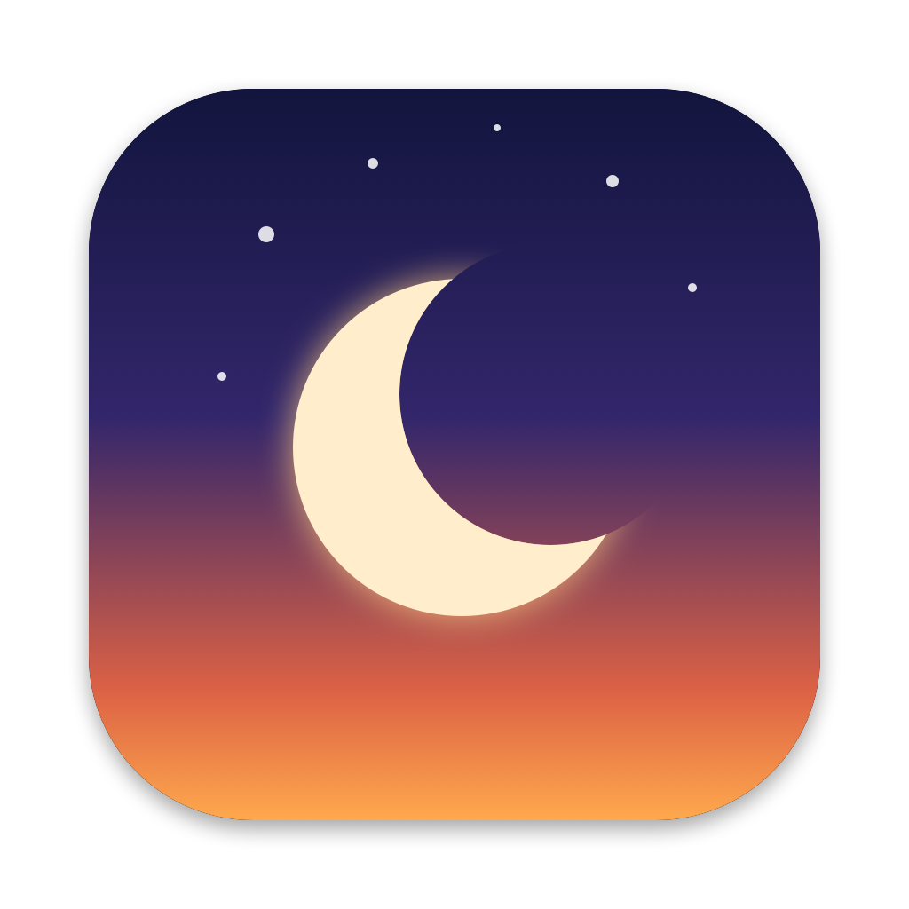
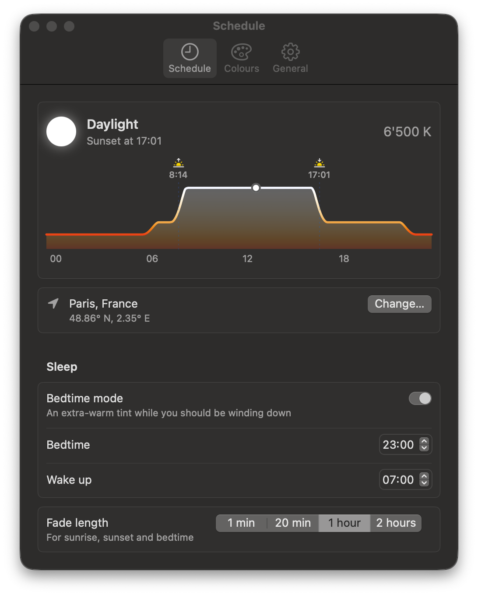
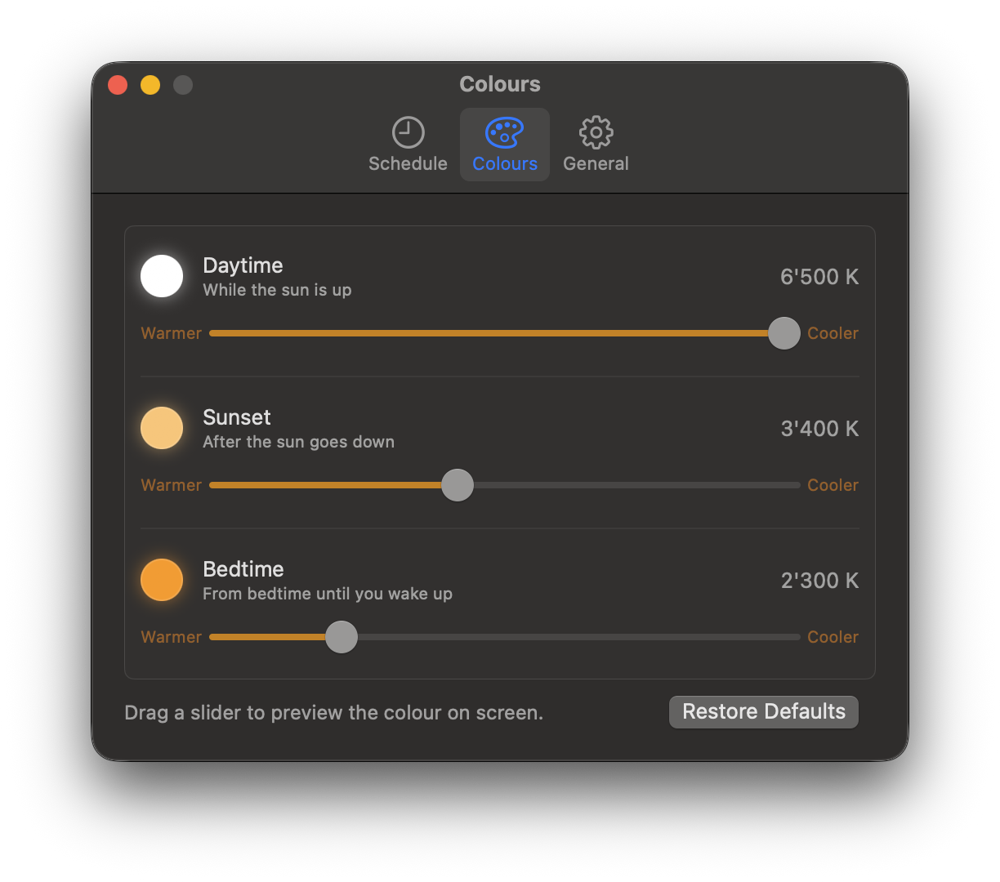
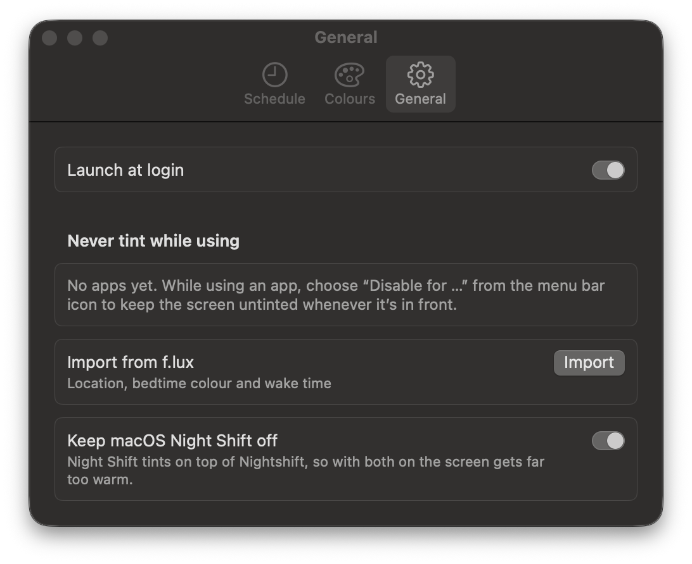

<p align="center">
  
</p>

<h1 align="center">Nightshift</h1>

<p align="center">
  A tiny, native macOS menu bar app that warms your screen after sunset and at bedtime.<br>
  Pure Swift · no dependencies · no account · works offline
</p>

<p align="center">
  
</p>

---

## Why

Bright, blue-heavy light late in the evening keeps you awake and is hard on the eyes.
Nightshift follows the sun where you live: full daylight colours while the sun is up, a
gentle fade to warm light at sunset, and an extra-warm bedtime mode until you get up.

It's a small, readable Swift codebase rather than a closed binary, with a few things done
deliberately well:

- **Keeps your calibration.** The tint is multiplied onto each display's own ColorSync
  curve instead of replacing it, so calibrated displays stay calibrated.
- **Stays applied.** macOS quietly resets gamma tables on wake, display hot-plug, user
  switching and colour-profile changes. Nightshift notices and re-applies.
- **Never leaves you orange.** Quitting, `kill`, Ctrl-C or logout restore the screen; a
  crashed instance is cleaned up on next launch, and `Nightshift --reset` is an escape hatch.
- **Physically based colour.** Temperatures come from Planck's law integrated against the
  CIE 1931 observer, not a curve-fit lookup, and 6500 K is exactly neutral.
- **Smooth everywhere.** Fades are interpolated in mireds (perceptually even), and the
  schedule is continuous across DST changes, midnight, polar day and polar night.

## Features

- Sunrise/sunset computed locally from your location: search for a city, use Location
  Services, or type coordinates
- Daytime, sunset and bedtime colours with a live on-screen preview while you drag
- Bedtime and wake-up times; fades of 1 minute up to 2 hours
- Pause for an hour, until morning, or entirely, from the menu bar
- "Disable for *this app*": stays untinted whenever, say, your photo editor is in front
- Keeps macOS Night Shift off, so the two tints don't stack
- Multi-display aware; displays that can't be tinted (some AirPlay/Sidecar/DisplayLink
  targets) are reported instead of silently ignored
- One-click import of an existing f.lux configuration (location, bedtime colour, wake time)
- Launch at login

<p align="center">
  
  
</p>

## Install

Requires macOS 14 or later and Xcode 16+ (Swift 6).

```sh
git clone https://github.com/bn4t/nightshift.git
cd nightshift
scripts/build-app.sh --install   # builds, ad-hoc signs, copies to /Applications
open /Applications/Nightshift.app
```

On first launch Settings opens so you can set your location. After that Nightshift lives in
the menu bar; open it again from Finder/Spotlight (or the menu bar icon) to get back to
Settings.

If you used f.lux before, quit it first: two apps writing gamma tables will flicker.

## Command line

```sh
Nightshift --print-schedule      # today's curve with your saved settings (touches no display)
Nightshift --night-shift-status  # is macOS Night Shift on?
Nightshift --reset               # restore all displays to their ColorSync curves
```

(The binary is at `/Applications/Nightshift.app/Contents/MacOS/Nightshift`, or
`.build/debug/Nightshift` after `swift build`.)

## How it works

| Piece | Where | What it does |
| --- | --- | --- |
| `SolarCalculator` | `NightshiftCore` | Offline sunrise/sunset (NOAA-style sunrise equation), polar day/night aware |
| `ColorTemperature` | `NightshiftCore` | Kelvin → RGB gains via blackbody spectrum × CIE 1931 (Wyman–Sloan–Shirley fit) → sRGB |
| `Schedule` | `NightshiftCore` | Daylight and bedtime factors → target temperature, mired interpolation, DST-safe |
| `GammaController` | app | Reads each display's transfer table once, writes scaled copies via `CGSetDisplayTransferByTable` |
| `TintController` | app | Timers, fades, pauses, per-app exclusions, re-applying after system events |
| `NightShift` | app | Turns macOS Night Shift off via CoreBrightness |

`NightshiftCore` has no AppKit dependency and is covered by tests:

```sh
swift test
```

## Privacy

Nightshift makes no network requests on its own. The only exception is city search in the
location picker, which uses Apple Maps while you type. "Use Current Location" asks
for permission once and stores the result rounded to about 1 km.

## Caveats

- Turning off Night Shift uses `CoreBrightness`, a private Apple framework. It's resolved
  at runtime, so if Apple changes it the toggle just disappears.
- Builds are ad-hoc signed. If Gatekeeper complains after copying the app to another Mac,
  right-click → Open once.

## Acknowledgements

Inspired by f.lux, which pioneered the idea. Nightshift is an independent project, not
affiliated with or endorsed by f.lux Software LLC, and shares no code with it.

## License

[MIT](LICENSE)
